# Product API

A simple Product API built with Go and the Gin web framework. Products are stored in memory, and the application is packaged with Docker and deployed to AWS ECS Fargate using Terraform.

This project implements only the Product endpoints from the provided `api.yaml` specification.

## Project Structure

```text
CS6650_2b_demo/
├── docker-compose.yml
├── src/
│   ├── Dockerfile
│   ├── product-service.go
│   ├── go.mod
│   └── go.sum
├── load_test/
│   ├── locustfile_httpuser.py
│   ├── locustfile_fast.py
│   ├── requirements.txt
│   ├── results/
│   └── screenshots/
├── observability/
│   ├── prometheus.yml
│   ├── request-log-excerpt.txt
│   ├── grafana/
│   │   └── product-api-red-dashboard.json
│   └── screenshots/
├── screenshots/
│   └── api/
├── terraform/
│   ├── main.tf
│   ├── provider.tf
│   ├── variables.tf
│   ├── outputs.tf
│   └── modules/
│       ├── ecr/
│       ├── ecs/
│       ├── logging/
│       └── network/
├── .gitignore
└── README.MD
```

## Technologies

- Go
- Gin
- Docker
- Locust
- Prometheus
- Grafana
- Terraform
- AWS ECR
- AWS ECS Fargate
- AWS CloudWatch
- AWS VPC and security groups

## Product Storage

Products are stored in an in-memory Go map:

```go
map[int32]Product
```

A `sync.RWMutex` protects the map so multiple Gin requests can safely read and update products concurrently.

The service starts with product ID `12345`, using the sample values from `api.yaml`. Seed data is necessary because the specification provides endpoints for retrieving and updating existing products but does not provide a separate endpoint for creating a product ID.

Because the data is stored in memory, all changes are lost when the application or container restarts.

## Product Schema

A product contains:

```json
{
  "product_id": 12345,
  "sku": "ABC-123-XYZ",
  "manufacturer": "Acme Corporation",
  "category_id": 456,
  "weight": 0,
  "some_other_id": 789
}
```

Validation rules:

- `product_id` must be a positive 32-bit integer.
- `sku` is required and must contain 1–100 characters.
- `manufacturer` is required and must contain 1–200 characters.
- `category_id` must be a positive 32-bit integer.
- `weight` is required and must be zero or greater.
- `some_other_id` must be a positive 32-bit integer.
- The body’s `product_id` must match the `productId` in the URL.

## Prerequisites

Install:

- Go 1.25 or later
- Docker Desktop
- Terraform
- AWS CLI

For AWS deployment, temporary AWS Learner Lab credentials are also required.

## Run Locally with Go

Enter the source directory:

```bash
cd src
```

Download dependencies:

```bash
go mod download
```

Run the server:

```bash
go run product-service.go
```

The server listens on:

```text
http://localhost:8080
```

Stop it with `Ctrl+C`.

## Run Locally with Docker

From the repository root, build the image:

```bash
docker build -t product-service ./src
```

Run the container:

```bash
docker run --rm -p 8080:8080 product-service
```

The API is available at:

```text
http://localhost:8080
```

Stop the container with `Ctrl+C`.

## API Endpoints

| Method | Endpoint | Description |
| --- | --- | --- |
| `GET` | `/v1/products/{productId}` | Retrieve an existing product |
| `POST` | `/v1/products/{productId}/details` | Replace the details of an existing product |

## Local API Examples

Run these commands while the Go server or Docker container is running.

### GET — 200 OK

Retrieve the seeded product:

```bash
curl -i http://localhost:8080/v1/products/12345
```

Example response:

```http
HTTP/1.1 200 OK
Content-Type: application/json
```

```json
{
  "product_id": 12345,
  "sku": "ABC-123-XYZ",
  "manufacturer": "Acme Corporation",
  "category_id": 456,
  "weight": 0,
  "some_other_id": 789
}
```

### GET — 404 Not Found

Request a product that does not exist:

```bash
curl -i http://localhost:8080/v1/products/99999
```

Example response:

```http
HTTP/1.1 404 Not Found
Content-Type: application/json
```

```json
{
  "error": "PRODUCT_NOT_FOUND",
  "message": "Product not found",
  "details": "Product ID 99999"
}
```

### POST — 204 No Content

Update the seeded product:

```bash
curl -i -X POST \
  http://localhost:8080/v1/products/12345/details \
  -H "Content-Type: application/json" \
  -d '{
    "product_id": 12345,
    "sku": "NEW-SKU-123",
    "manufacturer": "Updated Manufacturer",
    "category_id": 456,
    "weight": 100,
    "some_other_id": 789
  }'
```

Expected response:

```http
HTTP/1.1 204 No Content
```

A `204` response intentionally has no body.

Confirm the update:

```bash
curl -i http://localhost:8080/v1/products/12345
```

### POST — 400 Bad Request

This request omits the required `weight` field:

```bash
curl -i -X POST \
  http://localhost:8080/v1/products/12345/details \
  -H "Content-Type: application/json" \
  -d '{
    "product_id": 12345,
    "sku": "NEW-SKU-123",
    "manufacturer": "Updated Manufacturer",
    "category_id": 456,
    "some_other_id": 789
  }'
```

Example response:

```http
HTTP/1.1 400 Bad Request
Content-Type: application/json
```

```json
{
  "error": "INVALID_INPUT",
  "message": "Invalid product data",
  "details": "validation error details"
}
```

Other invalid input includes:

- A missing required field
- A non-positive ID
- A negative weight
- An empty required string
- A string exceeding its maximum length
- Malformed JSON
- A non-JSON request body
- Different product IDs in the URL and request body

### POST — 404 Not Found

Send valid details for an ID that does not exist:

```bash
curl -i -X POST \
  http://localhost:8080/v1/products/99999/details \
  -H "Content-Type: application/json" \
  -d '{
    "product_id": 99999,
    "sku": "TEST-SKU",
    "manufacturer": "Test Manufacturer",
    "category_id": 456,
    "weight": 100,
    "some_other_id": 789
  }'
```

Example response:

```http
HTTP/1.1 404 Not Found
Content-Type: application/json
```

```json
{
  "error": "PRODUCT_NOT_FOUND",
  "message": "Product not found",
  "details": "Product ID 99999"
}
```

### GET and POST — 500 Internal Server Error

Gin recovery middleware converts unexpected panics into the Error schema:

```json
{
  "error": "INTERNAL_SERVER_ERROR",
  "message": "Internal server error"
}
```

The in-memory map does not normally generate an internal failure. To test this response, a temporary middleware was added that forced a panic when the request contained:

```http
X-Test-Error: true
```

Example GET test:

```bash
curl -i \
  -H "X-Test-Error: true" \
  http://localhost:8080/v1/products/12345
```

Example POST test:

```bash
curl -i -X POST \
  http://localhost:8080/v1/products/12345/details \
  -H "Content-Type: application/json" \
  -H "X-Test-Error: true" \
  -d '{}'
```

Both requests returned:

```http
HTTP/1.1 500 Internal Server Error
```

The forced-error middleware was removed after testing so clients cannot intentionally cause server errors. The real Gin recovery middleware remains enabled.

## Response-Code Summary

| Endpoint | Response codes |
| --- | --- |
| `GET /v1/products/{productId}` | `200`, `404`, `500` |
| `POST /v1/products/{productId}/details` | `204`, `400`, `404`, `500` |

## Terraform Infrastructure

Terraform creates:

- An ECR repository for the Docker image
- An ECS Fargate cluster
- An ECS task definition
- An ECS service
- A security group allowing inbound traffic on port `8080`
- A CloudWatch log group
- Docker image building and pushing to ECR

The deployment uses:

```text
AWS region: us-east-1
Container port: 8080
ECS desired task count: 1
Docker platform: linux/amd64
```

## Deploy to AWS

### 1. Clone the repository

```bash
git clone https://github.com/zoyaarief/CS6650_2b_demo.git
cd CS6650_2b_demo
```

### 2. Start Docker Desktop

Terraform uses the local Docker daemon to build the image before pushing it to ECR.

### 3. Configure AWS credentials

Start the AWS Learner Lab and copy its temporary credentials.

```bash
aws configure
```

Enter:

```text
AWS Access Key ID: your temporary access key
AWS Secret Access Key: your temporary secret key
Default region name: us-east-1
Default output format: json
```

Set the temporary session token:

```bash
aws configure set aws_session_token "YOUR_TEMPORARY_SESSION_TOKEN"
```

Verify the identity:

```bash
aws sts get-caller-identity
```

Do not commit AWS credentials, session tokens, `.tfvars` files, or Terraform state.

### 4. Initialize Terraform

```bash
cd terraform
terraform init
```

### 5. Validate the configuration

```bash
terraform fmt -recursive
terraform validate
```

Expected:

```text
Success! The configuration is valid.
```

### 6. Review the deployment plan

```bash
terraform plan
```

Review the region, resource names, port, and resource counts before applying.

### 7. Deploy

```bash
terraform apply
```

Review the plan and type:

```text
yes
```

A successful deployment prints outputs similar to:

```text
Apply complete! Resources: 8 added, 0 changed, 0 destroyed.

Outputs:

ecs_cluster_name = "zoya-product-api-cluster"
ecs_service_name = "zoya-product-api"
```

## Find the Deployed Public IP

Wait for ECS to become stable:

```bash
aws ecs wait services-stable \
  --cluster zoya-product-api-cluster \
  --services zoya-product-api \
  --region us-east-1
```

Check the service:

```bash
aws ecs describe-services \
  --cluster zoya-product-api-cluster \
  --services zoya-product-api \
  --region us-east-1 \
  --query 'services[0].{desired:desiredCount,running:runningCount,pending:pendingCount}' \
  --output table
```

Expected:

```text
desired: 1
running: 1
pending: 0
```

Get the task ARN:

```bash
PRODUCT_TASK_ARN=$(aws ecs list-tasks \
  --cluster zoya-product-api-cluster \
  --service-name zoya-product-api \
  --region us-east-1 \
  --query 'taskArns[0]' \
  --output text)
```

Get its network interface:

```bash
PRODUCT_ENI_ID=$(aws ecs describe-tasks \
  --cluster zoya-product-api-cluster \
  --tasks "$PRODUCT_TASK_ARN" \
  --region us-east-1 \
  --query "tasks[0].attachments[0].details[?name=='networkInterfaceId'].value | [0]" \
  --output text)
```

Get the public IP:

```bash
PRODUCT_PUBLIC_IP=$(aws ec2 describe-network-interfaces \
  --network-interface-ids "$PRODUCT_ENI_ID" \
  --region us-east-1 \
  --query 'NetworkInterfaces[0].Association.PublicIp' \
  --output text)
```

Display it:

```bash
echo "$PRODUCT_PUBLIC_IP"
```

The public IP is temporary and can change when ECS replaces or redeploys the task.

## Test the Deployed API

GET `200`:

```bash
curl -i "http://$PRODUCT_PUBLIC_IP:8080/v1/products/12345"
```

GET `404`:

```bash
curl -i "http://$PRODUCT_PUBLIC_IP:8080/v1/products/99999"
```

POST `204`:

```bash
curl -i -X POST \
  "http://$PRODUCT_PUBLIC_IP:8080/v1/products/12345/details" \
  -H "Content-Type: application/json" \
  -d '{
    "product_id": 12345,
    "sku": "AWS-SKU-123",
    "manufacturer": "AWS Test Manufacturer",
    "category_id": 456,
    "weight": 100,
    "some_other_id": 789
  }'
```

## CloudWatch Logs

The ECS service sends container logs to:

```text
/ecs/zoya-product-api
```

Recent logs can be viewed with:

```bash
aws logs tail /ecs/zoya-product-api \
  --region us-east-1 \
  --since 10m
```

## Destroy the AWS Infrastructure

Destroy the resources when testing is complete to avoid consuming AWS Learner Lab resources:

```bash
cd terraform
terraform destroy
```

Review the destruction plan and type:

```text
yes
```

Expected:

```text
Destroy complete!
```

## API Verification Screenshots

The following screenshots show the required response codes locally and successful requests against the API deployed on AWS ECS.

### Local 200, 204, and 404 Responses

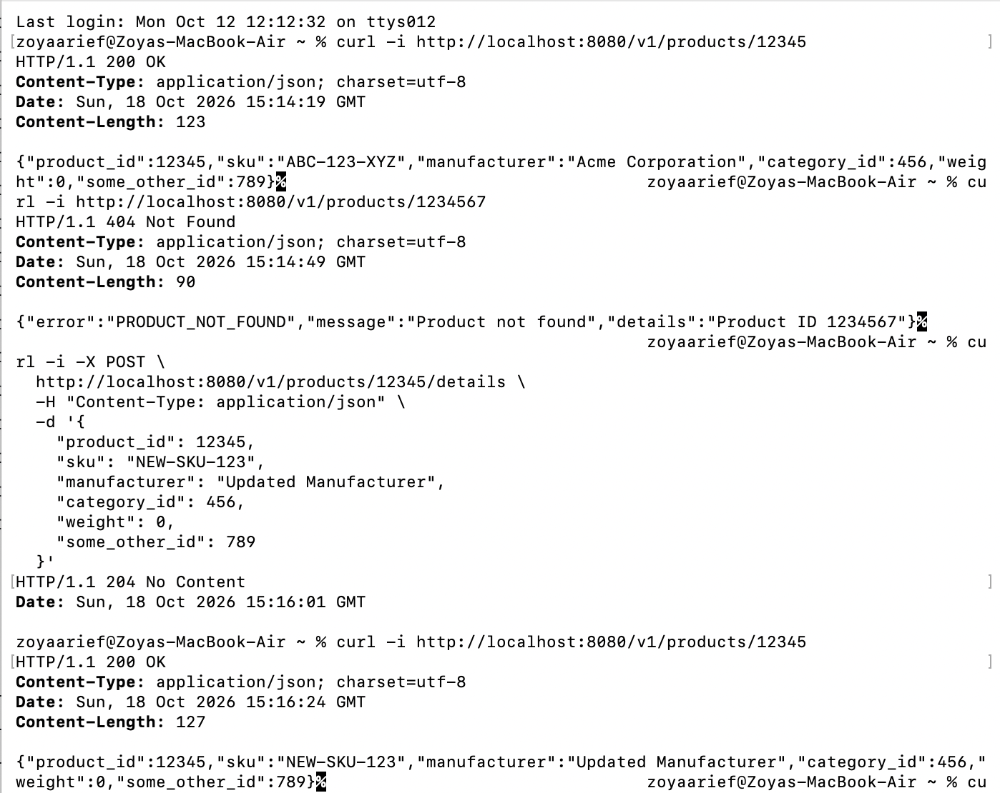

### Local 400 and 404 Responses

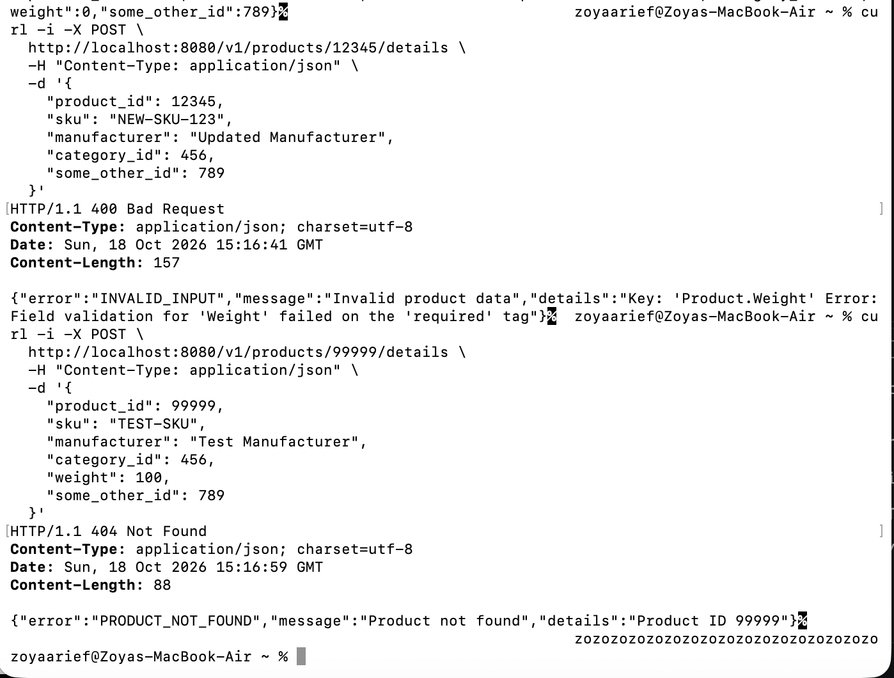

### Local 500 Response

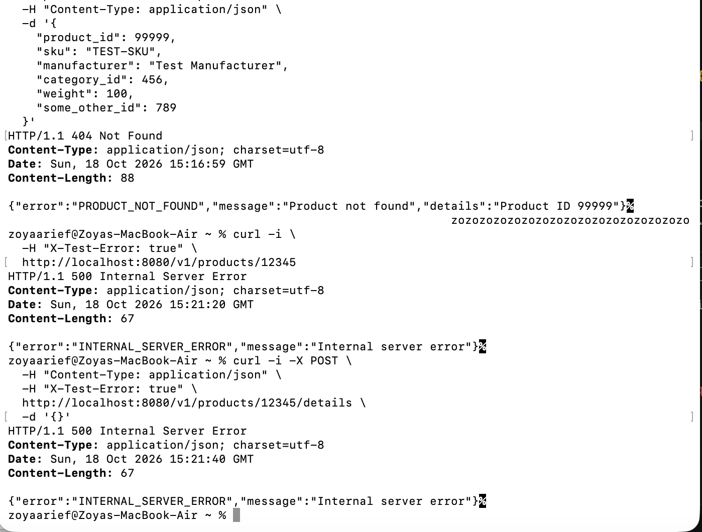

### AWS-Deployed API

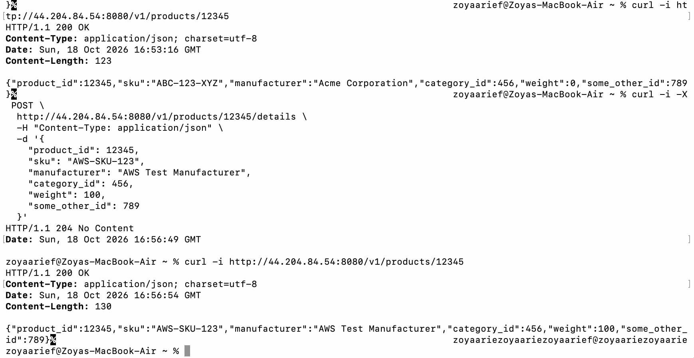

## Implementation Notes

- The API listens on port `8080`.
- Product routes use the `/v1` prefix.
- The Product struct follows the provided OpenAPI schema.
- Gin binding tags validate required fields and allowed values.
- `Weight` uses `*int32` so the server can distinguish a missing field from the valid value `0`.
- POST updates only an existing product ID.
- The URL `productId` and body `product_id` must match.
- A read/write mutex protects the in-memory map.
- Gin recovery middleware returns JSON-formatted `500` errors.
- Terraform builds a `linux/amd64` image for ECS Fargate.
- Terraform state, credentials, and other sensitive files must not be committed.

## Load Testing — Part IV

Locust used a 3:1 GET-to-POST task ratio because product reads are expected to be more common than product updates. The 50-user comparison used one local Locust process, a spawn rate of 10 users per second, a 60-second duration, and the same 1–2 second user wait time for both clients.

| Test | Requests | Failures | Requests/s | Average | Median | p95 | p98 | Maximum |
| --- | ---: | ---: | ---: | ---: | ---: | ---: | ---: | ---: |
| HttpUser, 50 users | 1,824 | 0 | 31.86 | 32.73 ms | 27 ms | 40 ms | 77 ms | 1,103 ms |
| FastHttpUser, 50 users | 1,907 | 0 | 31.94 | 29.55 ms | 26 ms | 47 ms | 79 ms | 269 ms |
| FastHttpUser, 200 users | 5,661 | 0 | 126.54 | 32 ms | 25 ms | 41 ms | 180 ms | 314 ms |
| FastHttpUser, 500 users | 14,020 | 0 | 313.35 | 53.85 ms | 26 ms | 77 ms | 720 ms | 2,418 ms |

At 50 users, `HttpUser` and `FastHttpUser` had almost identical throughput because the 1–2 second wait time, rather than client-side HTTP overhead, limited request generation. `FastHttpUser` had a slightly lower average and median and a substantially lower maximum response time in this run. It uses `geventhttpclient`, which has lower client-side overhead than the Python `requests`-based `HttpUser`, although Internet and ECS latency also vary between samples.

The service remained healthy at 200 users. At 500 users, it still returned no failures and throughput reached approximately 313 requests/s, but p98 rose to 720 ms and the maximum reached about 2.4 seconds. This widening tail latency marks the point at which the single 0.25-vCPU, 512-MiB Fargate task began to struggle. The API returned `200 OK` immediately after the test.

`sync.RWMutex` is appropriate for this read-heavy workload because concurrent GET operations can hold read locks together. Each POST needs the exclusive write lock and briefly blocks readers and other writers. At high concurrency, the 25% write share and the fact that every request targets the same product can contribute to lock contention.

Detailed HTML and CSV reports, test code, parameters, and analysis are stored under [`load_test/`](load_test/).

### HttpUser — 50 Users

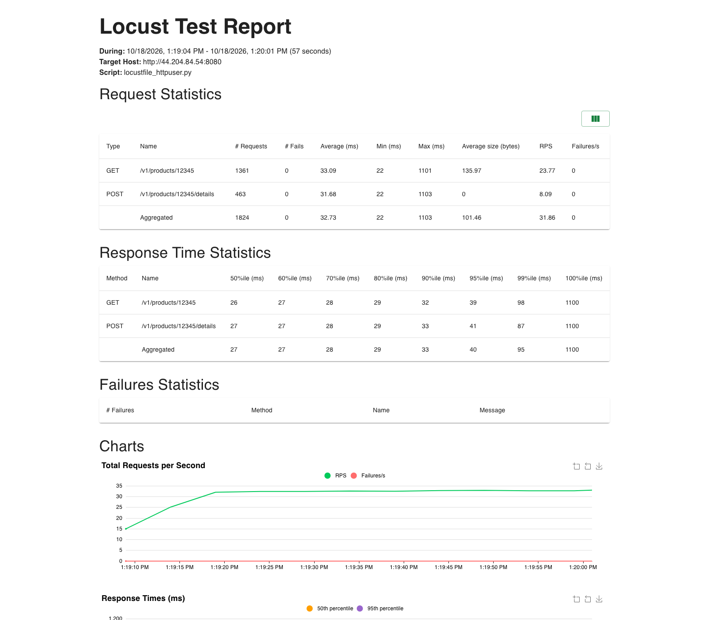

### FastHttpUser — 50 Users

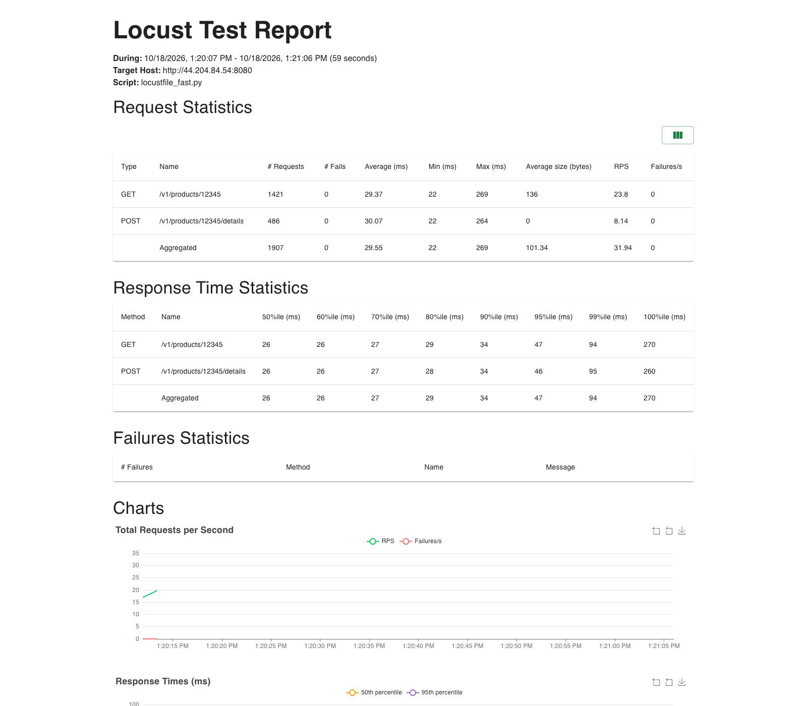

### FastHttpUser Stress Test — 500 Users

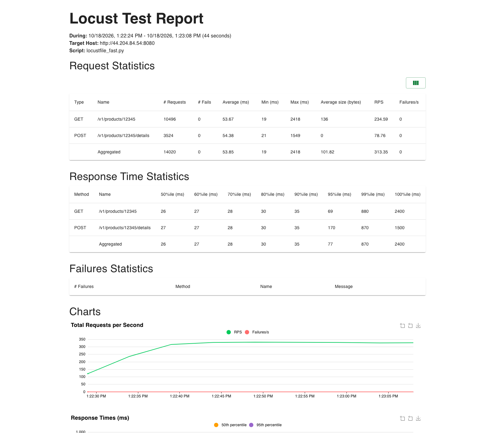

## Observability — Part V

The API exposes Prometheus metrics and emits one structured JSON log line for every API request. Prometheus and Grafana run locally with the Product API through Docker Compose; they are not deployed to AWS.

### RED Signals

The Gin middleware records each signal by HTTP method and route template:

| Signal | Prometheus metric | Meaning |
| --- | --- | --- |
| Rate | `product_api_requests_total` | Total requests, converted to requests/second with `rate()` |
| Errors | `product_api_errors_total` | Total non-2xx responses, displayed as a percentage of requests |
| Duration | `product_api_request_duration_seconds` | Request latency histogram used to calculate p50 and p95 |

Prometheus scrapes the metrics from:

```text
http://localhost:8080/metrics
```

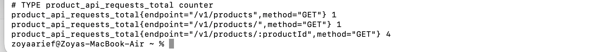

The `/metrics` scrape itself is excluded from the Product API measurements so monitoring traffic does not change the application results.

### Run the Local Observability Stack

From the repository root:

```bash
docker compose up -d --build
```

Check the services:

```bash
docker compose ps
```

The local services are:

| Service | URL |
| --- | --- |
| Product API | `http://localhost:8080` |
| Prometheus | `http://localhost:9090` |
| Grafana | `http://localhost:3000` |

Grafana uses `admin` for both the initial username and password. Add Prometheus as a Grafana data source using this URL:

```text
http://prometheus:9090
```

The reusable dashboard is stored at:

```text
observability/grafana/product-api-red-dashboard.json
```

To recreate it on another machine, open **Dashboards**, select **New → Import**, upload that JSON file, and select the Prometheus data source when prompted.

Stop the local stack without deleting the saved Grafana volume:

```bash
docker compose down
```

### Dashboard Queries

Rate in requests per second:

```promql
sum by (method, endpoint) (
  rate(product_api_requests_total[1m])
)
```

Percentage of non-2xx responses:

```promql
100 *
sum by (method, endpoint) (
  rate(product_api_errors_total[1m])
)
/
clamp_min(
  sum by (method, endpoint) (
    rate(product_api_requests_total[1m])
  ),
  0.000001
)
```

The Duration panel uses `histogram_quantile()` over `product_api_request_duration_seconds_bucket` to display p50 and p95 latency.

### Local Locust Run

The observability run used `FastHttpUser`, 50 concurrent users, a spawn rate of 10 users/second, a 3:1 GET-to-POST task ratio, and a 1–2 second wait between tasks. The UI run was stopped manually after collecting a full idle-to-loaded-to-idle dashboard window.

| Requests | Failures | Requests/s | Average | Median | p95 | p99 | Maximum |
| ---: | ---: | ---: | ---: | ---: | ---: | ---: | ---: |
| 3,008 | 0 | 32.73 | 3 ms | 2 ms | 3 ms | 20 ms | 283 ms |

GET processed 2,285 requests and POST processed 723, which is approximately the intended 3:1 read-to-write mix. The API sustained about 33 requests/second with no failures. Locust measured a 2 ms median and 3 ms p95. Grafana displayed approximately 2.5 ms p50 and 5 ms p95 because Prometheus estimates quantiles from histogram bucket boundaries.

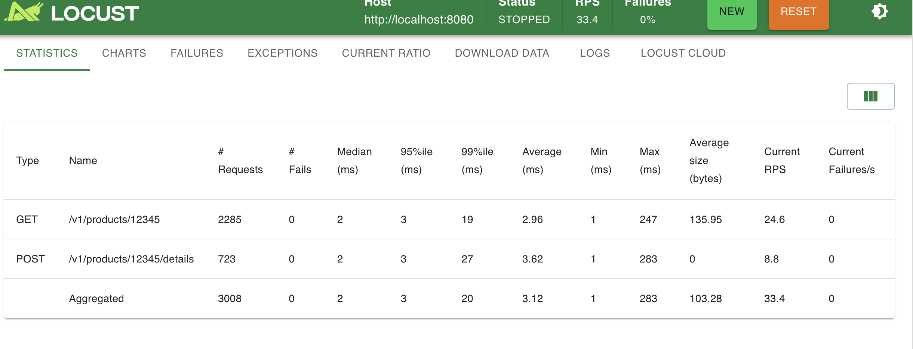

### Grafana: Idle Compared with Load

The dashboard shows the request rate rising during the Locust run and returning to zero afterward. GET reached about 25 requests/second, POST reached about 8 requests/second, and the error rate remained at 0%. The duration panel remained stable while the service was loaded.

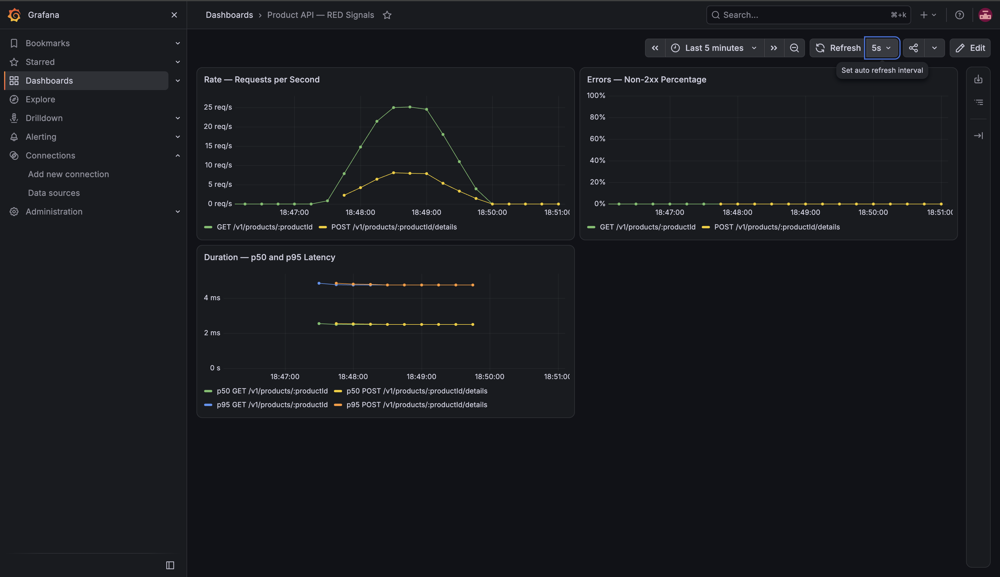

### Structured Request Logs

Each API request produces one JSON log containing its timestamp, method, route template, status code, and duration in milliseconds. This excerpt is from the same Locust run shown above:

```json
{"duration_ms":0.088792,"endpoint":"/v1/products/:productId/details","method":"POST","status":204,"timestamp":"2026-10-18T22:48:56Z"}
{"duration_ms":0.022708,"endpoint":"/v1/products/:productId","method":"GET","status":200,"timestamp":"2026-10-18T22:48:56Z"}
{"duration_ms":0.11820800000000001,"endpoint":"/v1/products/:productId/details","method":"POST","status":204,"timestamp":"2026-10-18T22:48:57Z"}
{"duration_ms":0.032666999999999995,"endpoint":"/v1/products/:productId","method":"GET","status":200,"timestamp":"2026-10-18T22:48:57Z"}
```

The complete short excerpt is stored in [`observability/request-log-excerpt.txt`](observability/request-log-excerpt.txt).

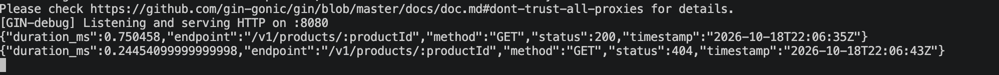

I would use the Grafana dashboard for real-time system health, trends, and quickly identifying when rate, errors, or latency changed. I would use the structured logs for after-the-fact debugging and for examining the exact endpoint, status, and duration of individual requests.

### Scalable Backend Design for the Full API

For the complete online-store API, I would keep the HTTP services stateless behind a load balancer and run multiple ECS tasks with automatic scaling. The API would be divided into clear domains such as products/catalog, users, carts, orders, inventory, and payments, allowing the busiest areas to scale independently.

Transactional data such as orders and payments would use a managed relational database such as Amazon Aurora or RDS. Frequently read product data could be cached in ElastiCache, product images could be stored in S3 and served through a CDN, and product search could use OpenSearch. SQS or EventBridge would handle asynchronous work such as order events, inventory updates, and notifications. Authentication, idempotency for write requests, database backups, secrets management, metrics, tracing, and centralized logs would also be included. This removes the single-process in-memory map and allows data and requests to survive container restarts and scale across many instances.

### Why Terraform Is Declarative

Terraform is declarative because the configuration describes the desired final infrastructure, such as an ECS service with a particular task count and network, rather than listing every command required to create it. Terraform compares that desired configuration with its state and the real infrastructure, builds a dependency graph, and produces a plan containing only the required changes.

An imperative approach would specify ordered steps such as create a VPC, then create subnets, then create a cluster, and then start a service. The declarative approach makes infrastructure repeatable, reviewable in version control, easier to reproduce on another machine, and safer to update because `terraform plan` shows the difference before anything is changed.
